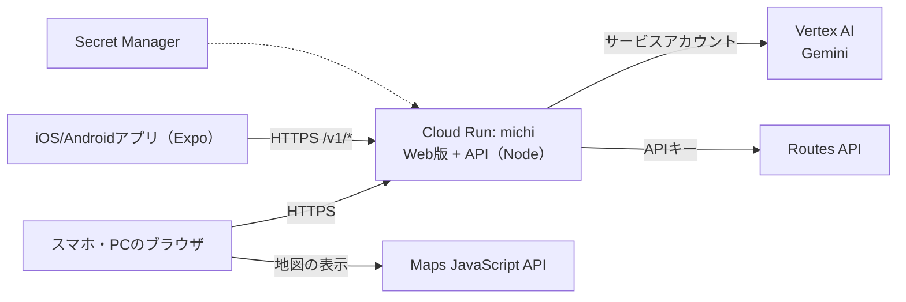

# MICHI?（ミチハテナ）

**いつもの道に、まだ知らない物語がある。**

目的地へ歩く道の途中に「？」を置くアプリです。近づくか、石碑や案内板の文字をカメラで写すと「？」が開きます。中には、出典つきの街の物語と、図鑑に集める発見カードが入っています。京都・三条周辺の6か所（高瀬川一之船入、池田屋騒動址、瑞泉寺、三条大橋の擬宝珠、駅伝の碑、高山彦九郎の像）を登録しています。石碑だけでなく、運河の跡、橋の飾り、人物の銅像も「？」になります。

DevFest GDGoC Japan Hackathon 2026 チーム「Overcoding!」の提出物です。

## 1分で試す

https://michi-176224264627.asia-northeast1.run.app をスマホで開きます。PCで開いた場合は、画面の中央にスマホの幅で表示されます。

1. 右上が「デモ」になっていることを確かめます。デモは位置情報を使いません。
2. 初めて開くと「まず、気になるものを1つ選ぶ」が出ます。例（「水路が好き」など）を押すか、好きなものを書きます。Geminiが言葉を視点タグに分け、関係する「？」が先に並びます。
3. 「最初の「？」を体験する」→「デモでここまで歩く」→「発見する」と進みます。出典つきの物語が開き、発見カードが図鑑に入ります。
4. 「次の「？」へ」で続けます。探索タブでは、通常ルートと発見ルートの所要時間（例：9分と14分、＋5分）を見比べて、「出発する」から歩くこともできます。ルートの「？」をすべて見つけると、コンプリートです。

デモの所要時間と位置は、体験用の仮データです。画面には「DEMO」を出し続け、記録は現地の分と分けて保存します。

## Googleの技術をどこに使っているか

| 技術 | 使いどころ | 選んだ理由 |
| --- | --- | --- |
| Gemini（Vertex AI） | ①好きなものの言葉を6つの視点タグに分ける ②次の「？」へ誘う一文 ③写真に写った文字の書き起こし ④視点別の解説の下書き（事前） | 人ごとに違う言い回しを、決まったタグに落とせる。縦書きの石碑の文字も読める。出力はJSONスキーマで受け、コードで検査する |
| Routes API | 寄り道ありとなしの徒歩時間を、実際の道で比べる | 寄り道の価値は「何分増えるか」で決まる。直線距離では嘘になる |
| Maps JavaScript API | Web版の地図と、道に沿ったルート線 | 審査員がPCでもスマホでも同じ地図を見られる |
| Cloud Run | Web版とAPIを1つのサービスで配信する | URL1つで触れる。サービスアカウントでGeminiを呼ぶので、APIキーを持たずに済む |
| Secret Manager | 地図とRoutesのキーを保管する | キーをリポジトリにもアプリにも入れない |



## AIの誤りへの備え

- Geminiに渡すのは、出典を確かめた事実（`src/data/catalog.json` の `facts`）だけです。
- ライブで出す一文は、表示する前にコードで検査します。渡していない事実のID、事実にない数字、次のスポットのネタバレ、長すぎる文のどれかがあれば捨てて、固定文に戻します（`server/ai.mjs` の `checkGeneratedText`）。
- 写真の判定では、どのスポットを期待しているかをGeminiに教えません。写っている文字だけを書き起こさせ、スポットの名前が含まれるかはコードが判定します。写真はどこにも保存しません。
- 解説の本文はライブで生成しません。Geminiの下書きを人が出典と照合し、通したものだけを表示します（`pnpm stories:review`）。照合済みがない組み合わせでは、カタログの基本の解説を出します。
- おすすめの順位は、タグの一致数でコードが決めます。順位の理由を説明できるようにするためです。
- 有料APIは、1日の回数の上限と利用期限をサーバー側で決めています。Geminiが使えないときは、キーワード照合と固定文で最後まで動きます。

検証の記録は [docs/VERIFICATION.md](docs/VERIFICATION.md)、APIの入出力は [docs/GOOGLE-CLOUD.md](docs/GOOGLE-CLOUD.md)、事実の出典は [docs/SOURCES.md](docs/SOURCES.md)、使った素材は [docs/CREDITS.md](docs/CREDITS.md) にあります。

## まず動かす

Node.js 24.3以上の24系（または22.13以上の22系）、pnpm 11系を使用します。リポジトリ直下で実行してください。

```sh
pnpm install
pnpm start
```

同じWi-Fiのスマートフォンで、Expo Goから表示されたQRコードを開きます。初期状態は「体験デモ」です。初回案内の「最初の『？』を体験する」から、「デモでここへ移動」→「立ち止まって、発見する」→「発見図鑑で見る」の順に試せます。目的地と寄り道時間を自分で選ぶこともできます。デモにAPIキーや位置情報の許可は不要です。

このプロジェクトはSDK 58対応のExpo Goで開きます。SDK 57との不一致が実機で発生したため、SDK 58へ更新済みです。バージョン不一致が表示された場合は、Expo Goの対応SDKとプロジェクトのSDKを確認してください。iOS実機では、Expo CLI（`pnpm exec expo login`）とExpo Goに同じExpoアカウントでログインします。アプリ内のユーザーログインは実装していません。[SDK更新手順](https://docs.expo.dev/workflow/upgrading-expo-sdk-walkthrough/)、[実機起動とログイン条件](https://docs.expo.dev/get-started/start-developing/)

Webで画面を確認する場合は次を使います。React Native Webの略図でUIを確認するためのプレビューであり、ネイティブ地図や実機GPSの検証は別途必要です。

```sh
pnpm web
```

## Expo Goから本番のサーバーにつなぐ

[.env.example](.env.example)を`.env`にコピーし、`EXPO_PUBLIC_API_URL=https://michi-176224264627.asia-northeast1.run.app`(Cloud Runの公開URL)を入れて`pnpm start`をやり直します。スマホのExpo Goから、本番のGemini(興味の分類・次の「？」への一言・写真の読み取り)とGoogle Routesを使えます。空欄のままなら、AIを使わない体験デモとして動きます。有料APIの回数は本番と共有なので、試しすぎに注意してください(1日50回まで)。

## Google Routesを接続する

[.env.example](.env.example)を`.env`にコピーし、アプリ側の`EXPO_PUBLIC_API_URL`(旧名`EXPO_PUBLIC_ROUTES_URL`も可)とサーバー側の`GOOGLE_ROUTES_API_KEY`を設定します。サーバーは別ターミナルで`pnpm server`を起動します。スマートフォンから接続する場合、URLには開発PCのLANアドレスを使用します。キーを設定するまでは空欄のままで構いません。

地図SDKの設定と経路APIは別です。iOSの既定地図はApple Mapsで、Googleの実経路線を重ねるにはGoogle Mapsを設定した独自ビルドが必要です。接続手順、環境変数、公開前の残作業は[Google Cloud接続メモ](docs/GOOGLE-CLOUD.md)にまとめています。[Google公式・Routes API](https://developers.google.com/maps/documentation/routes/compute_route_directions)、[Expo公式・地図設定](https://docs.expo.dev/versions/v58.0.0/sdk/map-view/)

## チェック

```sh
pnpm typecheck
pnpm test
pnpm test:server
```

ドメインのテストは距離判定・GPS情報の鮮度と精度・寄り道予算・保存データを確認します。サーバーのテストは入力検証やGoogle応答の処理を確認し、実Google APIは呼びません。

残っている検証(実機での一連の体験、実物の石碑の写真での読み取り、現地での座標の確認)は [docs/VERIFICATION.md](docs/VERIFICATION.md) の「未検証・未接続」にまとめています。

企画の採用範囲は[MVPの決定事項](docs/MVP.md)、スポットの根拠は[出典メモ](docs/SOURCES.md)を参照してください。
